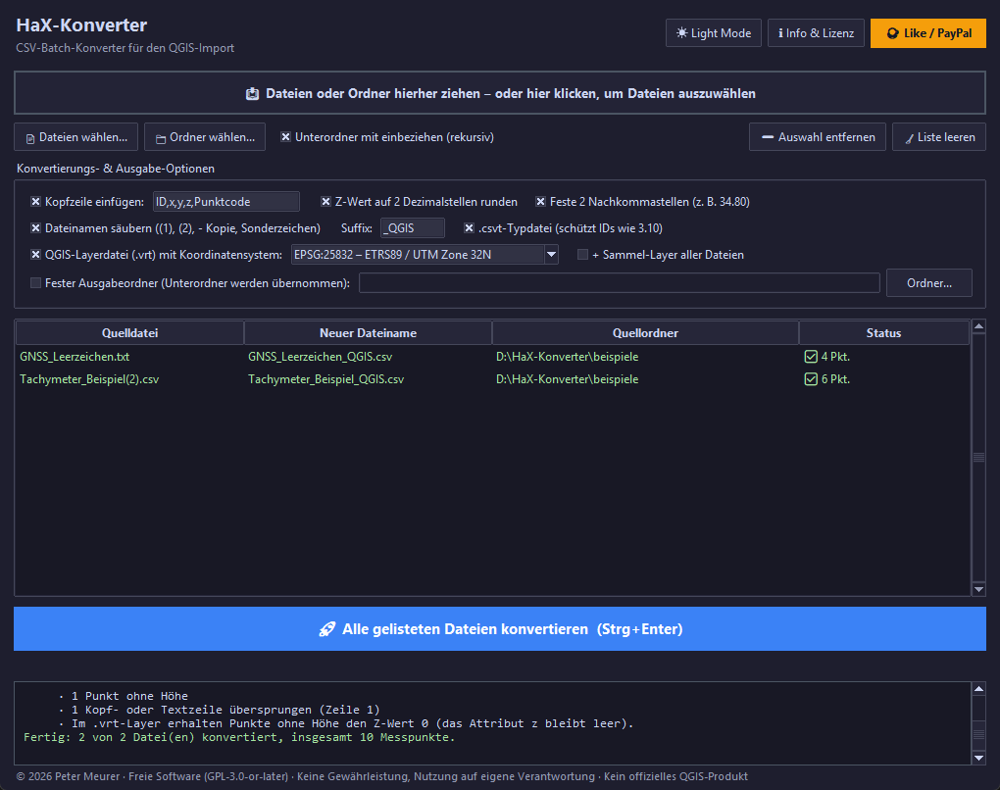

# HaX-Konverter

**CSV-Batch-Konverter für den QGIS-Import.** Ein schlankes Desktop-Tool (Python / Tkinter) mit grafischer Oberfläche und Drag & Drop. Es überführt Rohdaten aus der Vermessung (Tachymeter / GNSS) einzeln oder stapelweise in ein sauberes, direkt in **QGIS** ladbares Format (`ID,x,y,z,Punktcode`). Auf Wunsch entsteht dazu eine `.vrt`-Layerdatei mit Koordinatensystem: in QGIS hineinziehen, fertig.



> Kein offizielles QGIS-Produkt, siehe [Markenhinweis](#markenhinweis).

---

## ✨ Funktionen

* **Stapelverarbeitung & Ordner-Rekursion:** einzelne Dateien, Mehrfachauswahlen oder ganze Grabungs-/Projektordner inklusive Unterordner in einem Durchgang.
* **Drag & Drop:** Dateien und Ordner direkt aus dem Explorer in das Fenster ziehen.
* **Automatische Formaterkennung je Datei:**
  * Trennzeichen Semikolon, Tabulator, Komma oder Leerzeichen
  * Dezimalkomma oder Dezimalpunkt
  * Kodierung UTF-8, UTF-16, Windows-1252 oder DOS (cp850)
* **Schutz der Punktnummern:** IDs wie `3.10` oder `0010` bleiben exakt Text, in der CSV und dank `.csvt` bzw. `.vrt` auch in QGIS. Aus `3.10` wird also nicht `3.1`, aus `0010` nicht `10`.
* **Präzise Z-Wert-Rundung:** kaufmännisch (`ROUND_HALF_UP`) auf zwei Dezimalstellen, wahlweise mit festen Stellen (`34.80`) oder gekürzt (`34.8`).
* **Ehrliche Rückmeldung:**
  * Pro Datei siehst du die Zahl der übernommenen Punkte.
  * Übersprungene Zeilen werden mit Grund und Zeilennummern gemeldet, ebenso Punkte ohne Höhe, doppelte Punktnummern und Ausreißer (mehr als 10 km vom Großteil der Punkte entfernt).
  * Dateien ohne Messpunkte erzeugen keine (leere) Ausgabe. Das gilt auch für Höhenraster (ESRI-ASCII) und x-y-z-Geländemodelle, die oft im selben Projektordner liegen.
* **Sichere Dateinamen:**
  * Kopie-Zusätze wie `(1)`, `(2)` oder `- Kopie` sowie Leer- und Sonderzeichen werden entfernt, dazu kommt ein Suffix (Standard `_QGIS`).
  * Namenskonflikte werden erkannt und nummeriert (`Messung_2_QGIS.csv`), statt Ergebnisse zu überschreiben.
  * Quelldateien werden nie überschrieben, auch nicht über Netzlaufwerke oder Verknüpfungen.
  * Fremde Dateien gleichen Namens bleiben ebenfalls unangetastet (auch `.csvt`, `.vrt` und Sammel-Layer), das Ziel wird dann nummeriert. Eigene frühere Ausgaben werden nur nach Rückfrage ersetzt.
  * Jede Datei wird zuerst vollständig in eine Temp-Datei geschrieben. Ist die Ausgabe gerade in QGIS geöffnet, wird sie direkt überschrieben, damit erneutes Konvertieren trotzdem klappt.
* **QGIS-Layerdatei (`.vrt`) mit Koordinatensystem:**
  * Auswahl aus ETRS89/UTM 32N und 33N (auch mit Zonenkennung), DHDN/Gauß-Krüger Zone 2–5, „ohne KBS“ oder beliebigem `EPSG:`-Code.
  * Warnt, wenn die Koordinaten nicht zum gewählten System passen, und schlägt ein passendes vor.
  * Optional ein **Sammel-Layer** über alle Dateien eines Laufs, mit der Herkunftsspalte `Quelle`. Er wird bei jedem Lauf aktualisiert und enthält auch übersprungene, bereits vorhandene Ausgaben.
* **Fester Ausgabeordner** auf Wunsch. Die Unterordner-Struktur der Quellordner wird dabei übernommen.
* **Sauberer Ordner-Scan:** Folgende Dateien werden übersprungen:
  * bereits konvertierte Dateien, erkennbar am Suffix, an der eigenen `.csvt` oder an der Kopfzeile im Zielformat
  * versteckte Dateien
  * Excel-Sperrdateien (`~$…`)
* **Komfort:**
  * Dark / Light Mode
  * Fortschrittsbalken mit Abbrechen
  * scharfe Darstellung bei Windows-Skalierung (125 %, 150 %)
  * Tastenkürzel
  * Einstellungen werden gespeichert

---

## 🛠 Installation (Windows)

1. **Python 3.9 oder neuer** von [python.org](https://www.python.org/downloads/) installieren. Tkinter ist bereits enthalten.
2. **Optional für Drag & Drop:** in der Eingabeaufforderung
   ```
   py -m pip install tkinterdnd2
   ```
   Ohne dieses Paket funktioniert alles ebenfalls, dann wählst du Dateien über die Buttons aus.
3. Dieses Projekt herunterladen: auf GitHub **Code → Download ZIP** und entpacken (oder `git clone`).

Unter Linux wird zusätzlich das Paket `python3-tk` benötigt. Getestet ist das Programm unter Windows 10/11.

## ▶️ Start

* **Doppelklick auf `HaX-Konverter.pyw`** startet das Programm ohne Konsolenfenster.
* Alternativ in der Eingabeaufforderung im Projektordner:
  ```
  py HaX-Konverter.py
  ```
  So erscheinen eventuelle Fehlermeldungen zusätzlich in der Konsole.

## 🧭 Bedienung

1. Dateien oder Ordner in das Fenster ziehen oder über **Dateien wählen…** / **Ordner wählen…** hinzufügen.
2. Optionen prüfen. Die Liste zeigt vorab den neuen Dateinamen jeder Datei und ob eine vorhandene Datei ersetzt würde.
3. **Alle gelisteten Dateien konvertieren** klicken (oder `Strg+Enter`).
4. Status und Protokoll beachten:
   * ✅ ohne Warnungen. Hinweise (·) wie doppelte Punktnummern stehen nur im Protokoll.
   * ⚠ mit Warnungen, zum Beispiel übersprungene Datenzeilen oder Ausreißer
   * ❌ Fehler

   Ein **Doppelklick auf eine Zeile** zeigt die Details.
5. In QGIS die erzeugte `.vrt`-Datei ins Kartenfenster ziehen (siehe [Import in QGIS](#-import-in-qgis)).

**Tastenkürzel:**

| Taste | Wirkung |
|---|---|
| `Strg+O` | Dateien hinzufügen |
| `F5` | Ordner neu einlesen |
| `Entf` | markierte Dateien aus der Liste entfernen |
| `Strg+A` | alle Dateien der Liste markieren |
| `Strg+Enter` | konvertieren |

## 📥 Eingabeformat

Erwartet wird **eine Zeile pro Messpunkt** mit dieser Spaltenreihenfolge:

| Spalte | Inhalt | Pflicht |
|---|---|---|
| 1 | Punktnummer (bleibt Text) | ja |
| 2 | Rechtswert / Ost (QGIS: **x**) | ja |
| 3 | Hochwert / Nord (QGIS: **y**) | ja |
| 4 | Höhe (**z**) | nein |
| 5 | Punktcode / Beschreibung | nein |

* In der geodätischen Konvention heißt der Hochwert oft „X“. Maßgeblich ist hier nur die Reihenfolge: 2. Spalte Rechtswert/Ost, 3. Spalte Hochwert/Nord.
* Unterstützte Dateiendungen: `.csv`, `.txt`, `.asc`.
* Kopfzeilen, Vorspann-Text und Kommentarzeilen (beginnend mit `#` oder `//`) werden übersprungen und mit Zeilennummer gemeldet.
* Ob die 4. Spalte eine Höhe oder schon der Punktcode ist (`ID;x;y;Code`), wird je Datei erkannt: zuerst am Spaltennamen der Kopfzeile (z. B. „Höhe“, „Z“ bzw. „Code“), sonst an der Mehrheit der Werte. Ohne Höhe bleibt `z` leer.
* Platzhalter für fehlende Höhen wie `-`, `n.v.`, `nan` oder `NA` ergeben eine leere Höhe, der Punktcode bleibt erhalten. Eine Einheit `m` an der Höhe (`101,23m`) ist erlaubt.
* Bei Leerzeichen-getrennten Dateien darf der Punktcode Leerzeichen enthalten.
* Weitere Spalten nach dem Punktcode werden nicht übernommen. Das Protokoll weist darauf hin.

## 📤 Ausgabe

Aus `Messung (2).csv` entstehen im selben Ordner (oder im festen Ausgabeordner):

| Datei | Inhalt |
|---|---|
| `Messung_QGIS.csv` | UTF-8, kommagetrennt, Dezimalpunkt, Kopfzeile `ID,x,y,z,Punktcode` |
| `Messung_QGIS.csvt` | Feldtypen `"String","Real","Real","Real","String"`: Die ID bleibt in QGIS Text |
| `Messung_QGIS.vrt` | QGIS-/GDAL-Layer: Punkte aus x/y/z mit Koordinatensystem |
| `Sammellayer_QGIS.vrt` | optional: alle Dateien des Laufs in einem Layer |

## 🔄 Beispiel: Vorher / Nachher

Die Dateien liegen im Ordner [`beispiele/`](beispiele/). Alle Koordinaten sind frei erfunden.

**Eingangsdatei** `Tachymeter_Beispiel(2).csv` (Semikolon, Dezimalkomma, leere Endspalten):

```
PNr;Rechtswert;Hochwert;Höhe;Code;;;
3.1;500100,412;5600200,118;101,4449;Grabungsgrenze;;;
3.10;500101,873;5600201,904;101,4451;Grabungsgrenze;;;
3.11;500103,290;5600203,512;101,3870;Grabungsgrenze;;;
0010;500105,005;5600199,760;100,9950;Befund 12 Oberkante;;;
0011;500105,840;5600198,935;100,8125;Befund 12 Unterkante;;;
12;500107,118;5600201,333;;Fundpunkt;;;
```

**Ausgabedatei** `Tachymeter_Beispiel_QGIS.csv`:

```
ID,x,y,z,Punktcode
3.1,500100.412,5600200.118,101.44,Grabungsgrenze
3.10,500101.873,5600201.904,101.45,Grabungsgrenze
3.11,500103.290,5600203.512,101.39,Grabungsgrenze
0010,500105.005,5600199.760,101.00,Befund 12 Oberkante
0011,500105.840,5600198.935,100.81,Befund 12 Unterkante
12,500107.118,5600201.333,,Fundpunkt
```

**Protokoll:**

```
✅ Tachymeter_Beispiel(2).csv → Tachymeter_Beispiel_QGIS.csv: 6 Punkte (UTF-8, Semikolon)
     · 1 Punkt ohne Höhe
     · 1 Kopf- oder Textzeile übersprungen (Zeile 1)
     · Im .vrt-Layer erhalten Punkte ohne Höhe den Z-Wert 0 (das Attribut z bleibt leer).
```

## 🗺 Import in QGIS

**Empfohlen: die `.vrt`-Datei.** Ziehe `…_QGIS.vrt` in das QGIS-Kartenfenster (oder *Layer → Layer hinzufügen → Vektorlayer hinzufügen*). Es entsteht sofort ein 3D-Punktlayer mit dem gewählten Koordinatensystem, und die Punktnummern bleiben Text. Punkte ohne Höhe erhalten in der Geometrie den Z-Wert 0, das Attribut `z` bleibt leer.

**Alternativ über „Getrennte Texte“:** *Layer → Layer hinzufügen → Getrennte Textdatei als Layer hinzufügen…*, die `…_QGIS.csv` wählen und bei der Geometrie X-Feld `x`, Y-Feld `y` und Z-Feld `z` sowie das Koordinatensystem einstellen. Die `.csvt` sorgt dafür, dass die Punktnummern auch bei aktivierter Feldtyperkennung Text bleiben.

Getestet mit QGIS 3.36 (GDAL 3.8).

## ⚙️ Optionen und Standardwerte

| Option | Standard | Bedeutung |
|---|---|---|
| Unterordner mit einbeziehen | an | Ordner rekursiv durchsuchen |
| Kopfzeile einfügen | `ID,x,y,z,Punktcode` | genau 5 Namen, getrennt durch `,` oder `;` |
| Z-Wert runden | an | kaufmännisch auf 2 Stellen |
| Feste 2 Nachkommastellen | an | `34.80` statt `34.8` |
| Dateinamen säubern | an | entfernt `(1)`, `(2)`, `- Kopie`, Leer- und Sonderzeichen |
| Suffix | `_QGIS` | erlaubt: Buchstaben, Ziffern, `_`, `-`; leer nur mit festem Ausgabeordner |
| `.csvt`-Typdatei | an | schützt Punktnummern beim Import über „Getrennte Texte“ |
| QGIS-Layerdatei (`.vrt`) | an, `EPSG:25832` | Layer mit Koordinatensystem; Plausibilitätsprüfung der Koordinaten |
| Sammel-Layer | aus | ein `.vrt`-Layer über alle Dateien des Laufs |
| Fester Ausgabeordner | aus | sonst wird im jeweiligen Quellordner gespeichert |

Die Einstellungen werden beim Beenden gespeichert, unter Windows in `%APPDATA%\HaX-Konverter\einstellungen.json`.

## ⚠️ Grenzen

* Die Spaltenreihenfolge ist fest (siehe [Eingabeformat](#-eingabeformat)). Andere Reihenfolgen, zum Beispiel Hochwert vor Rechtswert, müssen vorher umgestellt werden.
* Gerätespezifische Formate wie Leica GSI, Trimble JobXML oder DXF werden nicht direkt gelesen. Bitte vorher als Text/CSV exportieren.
* Die Plausibilitätsprüfung der Koordinaten gibt es nur für die Koordinatensysteme der Auswahlliste.
* Pro Datei gilt ein Trennzeichen. Zeilen mit abweichendem Trennzeichen, etwa in zusammengefügten Exporten, werden mit Zeilennummer gemeldet, aber nicht übernommen.
* Ohne Kopfzeile lässt sich eine 4. Spalte, die nur aus Zahlen besteht, nicht von einer Höhe unterscheiden. Sie wird dann als Höhe gelesen.
* Leerzeichen-getrennte Dateien gelten nur als Messdaten, wenn die Mehrheit der Zeilen Koordinaten mit Nachkommastellen (bzw. ab 1000) oder eine Höhe enthält. Freitext-Notizen werden so in aller Regel erkannt und übersprungen.
* Frühere Ausgaben erkennt das Programm an der Kopfzeile `ID,x,y,z,Punktcode`, an der eigenen `.csvt` bzw. `.vrt` oder daran, dass sie in derselben Sitzung entstanden sind. Ohne diese Merkmale wird eine vorhandene Datei nicht ersetzt, sondern das neue Ziel nummeriert.

## 🧪 Entwicklung & Tests

Die Kernlogik ist von der Oberfläche getrennt und mit der Standardbibliothek getestet:

```
py -m unittest discover -s tests -v
```

Änderungen sind im [CHANGELOG](CHANGELOG.md) dokumentiert.

## 📄 Lizenz

© 2026 Peter Meurer. Freie Software unter der **GNU General Public License, Version 3 oder später** (`GPL-3.0-or-later`), siehe [LICENSE](LICENSE).

Dieses Programm wird ohne jede Gewährleistung bereitgestellt. Die Nutzung erfolgt auf eigene Verantwortung, der Autor übernimmt keine Haftung für Schäden, Datenverluste oder Fehlinterpretationen der Ergebnisse.

## Markenhinweis

QGIS ist eine Marke von QGIS.ORG. Der HaX-Konverter ist kein offizielles QGIS-Produkt und steht in keiner Verbindung zu QGIS.ORG. „QGIS“ wird hier nur beschreibend verwendet, um den Einsatzzweck zu nennen.

## ☕ Unterstützung

Unterstützung und Weiterentwicklung sind willkommen: [paypal.me/PeMeurer](https://paypal.me/PeMeurer)
